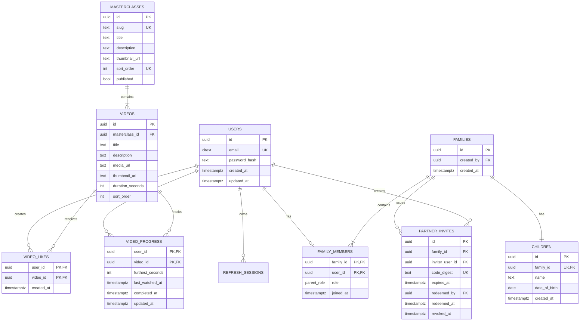

# Sitaara — Partner Linking & Shared Progress

> Full-stack parenting application slice built with **Go** (backend) + **Flutter** (Android) + **PostgreSQL** (Supabase) + **Cloudinary** (video CDN).  
> Two parents create separate accounts, link around one child profile via single-use invites, and share learning progress and likes across masterclasses.

---

## Deliverables & Quick Links

- **Hosted API:** [`https://sitaara-production.up.railway.app`](https://sitaara-production.up.railway.app)
  - Health check: [`/healthz`](https://sitaara-production.up.railway.app/healthz) (`status: ok`)
  - Readiness check: [`/readyz`](https://sitaara-production.up.railway.app/readyz) (`status: ready`)
- **Signed Release APK:** [`artifacts/Sitaara-1.0.0+1-release.apk`](artifacts/Sitaara-1.0.0+1-release.apk)
  - **Size:** 57,026,176 bytes (54.4 MB)
  - **SHA-256:** `10CAE0145BB3A9B2BCC12F9DB599DE39972DCA4853DE8553A04E0C2E54FF4C4F`
  - **Signature Scheme:** APK Signature Scheme v2 (verified)
  - **Application ID:** `com.vgpl.sitaara` | **Min SDK:** 24 | **Target SDK:** 36
- **Architecture & Technical Documentation:** [`docs/`](docs/)

---

## Reviewer Flow & Demo Credentials

### Option A: Instant Review with Pre-Seeded Accounts (Recommended)

Both accounts are pre-seeded and linked to the fictional child **Tara** (age 3) with contrasting watch progress and likes across both masterclasses:

| Parent | Email | Role | Password |
|---|---|---|---|
| **Mom** | `mom.demo@sitaara.example` | Mom | `SitaaraDemo2026!` |
| **Dad** | `dad.demo@sitaara.example` | Dad | `SitaaraDemo2026!` |

1. Log in as **Mom** (`mom.demo@sitaara.example`).
2. Observe the shared child header (**Tara, 3 years old**) and the two masterclasses with aggregated progress bars.
3. Open **"Newborn Sleep Rhythms"**: notice Dad's progress banner (*"Dad has completed 2/4 videos (55%)"*) and like badges (*"Liked by Dad"*).
4. Play a lesson, seek forward, and tap the Like heart.
5. Log out and sign in as **Dad** (`dad.demo@sitaara.example`): observe that Mom's updated watch progress and like are immediately reflected.
6. Notice the **"Currently Watching"** indicator when a partner has active playback within the last 10 minutes.

### Option B: Fresh Two-Account Registration & Linking Flow

1. Register Parent 1 with role **Mom**, and create the child profile (Name: *Tara*, Date of Birth: *2023-04-10*).
2. Tap **"Invite Partner"** to generate a single-use 6-character code (valid for 24 hours).
3. Register Parent 2 independently with role **Dad**.
4. Select **"I Have an Invite Code"**, enter the code, and confirm.
5. Both accounts are now atomically linked around the child and share mutual content activity.

---

## The Write-Up

### 1. How It Was Built & Engineering Process

The solution was approached systematically as an end-to-end production vertical slice:

```text
1. Requirements & Threat Modeling  ──> Map assignment brief to strict domain rules & state invariants
2. Prototype & UX Validation        ──> Standalone HTML/CSS/JS design reference in prototype/
3. PostgreSQL Schema & Migrations  ──> Normalized relational model with Goose migrations & SQL constraints
4. Go API & Concurrency Protection ──> Pure sqlc queries, row locks (FOR UPDATE), Argon2id auth, rate limiting
5. Content Catalog & Media Delivery──> 9 Cloudinary MP4 video streams & auto-generated poster frames
6. Flutter Mobile Application      ──> Clean feature separation, reusable video player, optimistic state
7. Verification & Physical Testing ──> 25 Flutter tests + Go test suite, signed release APK on real hardware
```

1. **Requirements & Domain Modeling:** Analyzed the 3-page assignment specification, documented edge cases (linking races, out-of-order packets, IDOR authorization), and produced formal architecture docs in [`docs/`](docs/).
2. **Design Reference:** Created a standalone mobile interaction reference in [`prototype/`](prototype/) using Sitaara's brand palette (Primary `#462E91`, Accent `#8AC340`) to validate layout and UX before writing Flutter code.
3. **Backend Foundation:** Built the Go service with strict layering: HTTP routing via `chi`, compile-time SQL verification via `sqlc`, and migration management via `goose`.
4. **Data Isolation & Concurrency Control:** Implemented row-level locks on invite redemption to make concurrent redemption race-free, and atomic upserts for watch progress.
5. **Flutter Implementation:** Implemented presentation, controller, and repository layers. Built a reusable, crash-resilient `SitaaraVideoPlayer` with full-screen support, seek reporting, and partner activity overlays.
6. **Hardware Verification:** Built and signed release APKs, verified signature schemes, and exercised the full two-account story on physical hardware (Motorola edge 60 pro).

---

### 2. Data Model & Entity Relationship Diagram



---

### 3. Key Technical Decisions ("Why This, Why Not That")

| Technical Choice | Rationale ("Why this?") | Alternative Considered & Rejected ("Why not that?") |
|---|---|---|
| **Go (`chi` + `sqlc`)** | Single static binary, instant cold start, minimal memory footprint (~25 MB on Railway), native concurrency, explicit error checking. | **Node/Express:** Single-threaded event loop blocks on CPU tasks (Argon2id hashing); dynamic typing pitfalls.<br>**Python/FastAPI:** Higher latency, larger container image, GIL concurrency limits. |
| **PostgreSQL (Supabase)** | ACID transaction guarantees for invite redemption (`FOR UPDATE`), advanced SQL CTEs, atomic `GREATEST`/`LEAST`, composite unique constraints. | **MongoDB/NoSQL:** Lack of multi-document ACID isolation by default; risk of race conditions during concurrent invite redemptions. |
| **`sqlc` (Compile-time SQL)** | Generates type-safe Go code directly from pure SQL. Zero runtime reflection, complete visibility into queries, no hidden N+1 query surprises. | **GORM / ORMs:** Heavy reflection, magical query generation, difficult to tune locking clauses and complex aggregations. |
| **Native Flutter Android APK** | Hardware-accelerated video decoding, smooth gesture scrub/seeking, signed release APK tested on physical hardware. | **Flutter Web:** Heavy initial download bundle, browser autoplay policies, CORS issues during video streaming, poor mobile touch UX. |
| **Cloudinary (Video CDN)** | Optimized adaptive MP4 byte-range streaming (critical for instant seeking) and automatic frame poster extraction. Zero write secrets in client. | **Raw S3 / Supabase Storage:** Lacks dynamic video transcoding, frame poster extraction, and streaming delivery optimization. |
| **Railway Hosting** | Seamless Docker builds, automated HTTPS, integrated pre-deploy migration hooks (`/app/sitaara-migrate up`), health check integration. | **Render / Fly.io:** Railway offered the cleanest monorepo subfolder deployment and environment management. |

---

### 4. Edge Cases & Domain Rules

#### A. Linking Integrity & Concurrency Race Conditions
- **Concurrent Redemption Race:** If two users enter the same invite code simultaneously, PostgreSQL row-level locking handles it deterministically:
  ```sql
  SELECT id, family_id, inviter_user_id, redeemed_at, expires_at 
  FROM partner_invites 
  WHERE code_digest = $1 
  FOR UPDATE;
  ```
  The first transaction locks the row, validates, completes redemption, and commits. The second request unblocks, inspects `redeemed_at IS NOT NULL`, and fails cleanly with `ErrInviteAlreadyUsed` (HTTP 409).
- **Self-Linking Prevention:** Rejected if `invite.InviterUserID == userID` (`ErrSelfLinkNotAllowed`).
- **Silently Re-linking Prevention:** Rejected if the user already belongs to a family (`ErrAlreadyInFamily`).
- **Role Constraints:** DB unique constraint `UNIQUE (family_id, role)` strictly enforces one Mom and one Dad per family.
- **Low-Entropy Code Security:** 6-character codes are never stored in plaintext. The database stores only an HMAC-SHA256 digest (`INVITE_HMAC_SECRET`).

#### B. Monotonic Watch Progress
Progress must **never move backwards** regardless of rewinding, seeks, or out-of-order network requests:
```sql
INSERT INTO video_progress (user_id, video_id, furthest_seconds, last_watched_at, completed_at, updated_at)
VALUES ($1, $2, LEAST($3, v.duration_seconds), now(), ...)
ON CONFLICT (user_id, video_id) DO UPDATE
SET furthest_seconds = GREATEST(video_progress.furthest_seconds, EXCLUDED.furthest_seconds),
    last_watched_at = EXCLUDED.last_watched_at,
    completed_at = CASE 
        WHEN video_progress.completed_at IS NOT NULL THEN video_progress.completed_at
        WHEN GREATEST(video_progress.furthest_seconds, EXCLUDED.furthest_seconds) * 10 >= (SELECT duration_seconds FROM videos WHERE id = EXCLUDED.video_id) * 9 
        THEN EXCLUDED.last_watched_at 
    END;
```
1. `GREATEST()` ensures furthest progress is strictly monotonically increasing.
2. `LEAST(position, duration)` clamps client-reported positions to the canonical server duration.
3. `Sticky Completion:` A video is completed at 90% duration. Once `completed_at` is set, rewinding never revokes it.

#### C. Duration-Weighted Masterclass Progress
Rather than an unweighted average of video percentages (which treats a 1-minute intro equal to a 15-minute core lesson), masterclass progress is duration-weighted:
$$\text{Progress \%} = \left\lfloor 100 \times \frac{\sum \min(\text{furthest\_seconds}_i, \text{duration}_i)}{\sum \text{duration}_i} \right\rfloor$$

#### D. "Currently Watching" Indicator
A partner is shown as "Currently Watching" a masterclass if an incomplete video received a progress update within the previous 10 minutes (`last_watched_at >= now() - interval '10 minutes'`). Completed lessons and stale sessions do not trigger a false live signal.

#### E. Strict Authorization & Privacy Isolation
Handlers never accept a `family_id` or `partner_id` parameter from the client. The server extracts the authenticated `user_id` from the verified JWT access token, queries `family_members` for that user's `family_id`, and joins `partner.user_id <> own.user_id`. Unlinked users receive null partner activity. Cross-family data leakage is impossible.

---

### 5. AI Usage, Human Ownership & Verification

Transparent engineering disclosure per the assignment guidelines:

#### What Was AI-Assisted:
- Drafting initial Go boilerplate structures, configuration parsers, and repetitive SQL query skeletons.
- Translating the standalone CSS/prototype visual layout into Flutter widget hierarchies.
- Drafting initial unit test cases and mock repository fixtures.

#### What Was 100% Human-Owned:
- **Architecture & System Boundaries:** Choosing a native Flutter Android APK over Flutter Web, and Go-owned auth over third-party auth.
- **Transactional & Locking Design:** Establishing row-level locking (`FOR UPDATE`) for invite redemption and atomic upserts for progress.
- **Domain Formulations:** Developing the duration-weighted progress formula and 10-minute activity threshold.
- **Security Engineering:** HMAC hashing for invite codes, Argon2id parameters, and refresh token rotation with replay revocation.

#### Real Defects Caught & Corrected During Review:
1. **Existing-Family Login Routing:** Initial login response defaulted `needs_family = true`, causing seeded Mom/Dad accounts to land on onboarding. Caught during real-device testing; fixed by deriving family membership during session creation and reconciling via `/v1/me`.
2. **Postgres Aggregate Null Trap:** PostgreSQL `LEAST(NULL, duration)` evaluated to `NULL` for unwatched videos in the masterclass aggregate, causing 0% classes to evaluate to 100%. Caught and fixed by adding `COALESCE(me_progress.furthest_seconds, 0)`.
3. **Gradle JVM Memory Crash:** Default Gradle 8 GB heap allocation crashed on the 16 GB Windows development machine during `assembleRelease`. Capped Gradle to 2 GB heap in `gradle.properties`.

---

## Repository Structure

```text
Sitaara/
├── assets/          # Supplied brand assets and vectors
├── backend/         # Go REST API (Railway service root)
│   ├── cmd/api/     # API entrypoint
│   ├── cmd/migrate/ # Database migration runner
│   ├── cmd/seed/    # Idempotent catalog & demo family seeder
│   ├── internal/    # Auth, Family, Content, Postgres, HTTP API
│   ├── migrations/  # Goose SQL migration files
│   ├── queries/     # sqlc SQL query definitions
│   └── scripts/     # dev.ps1 automation script
├── docs/            # Architecture specifications, runbooks, and ADRs
├── mobile/          # Flutter Android application
│   ├── android/     # Gradle build scripts and signing configuration
│   ├── lib/         # Core theme/network and feature modules
│   └── test/        # 25 unit, widget, and controller tests
├── prototype/       # Approved standalone HTML/CSS/JS design reference
└── artifacts/       # Signed release APK for reviewer evaluation
```

---

## Local Development & Verification

### Prerequisites
- Go 1.27+
- Flutter 3.47+ / Dart 3.13+
- PostgreSQL 17+
- Android SDK 36 (min SDK 24), OpenJDK 21

### Backend Verification
From the repository root (PowerShell):
```powershell
backend\scripts\dev.ps1 format
backend\scripts\dev.ps1 lint
backend\scripts\dev.ps1 test
```

### Running Backend Locally
```powershell
backend\scripts\dev.ps1 migrate-up
backend\scripts\dev.ps1 seed
backend\scripts\dev.ps1 run
```

### Flutter Verification & Build
From `mobile/`:
```powershell
dart format --set-exit-if-changed lib test
flutter analyze --no-pub
flutter test --no-pub
flutter build apk --release --no-pub
```

The app defaults to calling the hosted Railway API (`https://sitaara-production.up.railway.app`). No mobile credentials or local database setup are required to run the app.
