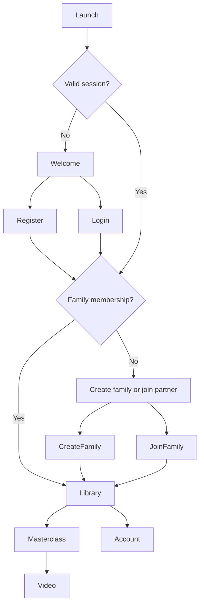

# User Flows

**Status:** Draft for review  
**Last updated:** 2026-10-16  

## Navigation model

The app uses an authentication gate followed by an onboarding gate.

## Prototype coverage

The `/prototype` experience must make every flow below reachable with local mock data, including both linked and unlinked states. It may simulate latency, progress, authentication, invite redemption, and errors for design review, but those simulations do not define or prove backend behavior. The approved navigation, wording, hierarchy, and recovery patterns become the reference for Flutter.

## Flow A: register and create family

1. User opens Sign Up.
2. User enters email, password, and password confirmation.
3. App submits registration and stores the returned token pair securely.
4. API reports that onboarding is incomplete.
5. User chooses **Create a family**.
6. User chooses Mom or Dad.
7. User enters child name and DOB.
8. App validates obvious input and submits one creation request.
9. Backend creates family, membership, and child in one transaction.
10. User lands on the library with child context and an invitation prompt.

Failure recovery:

- Duplicate email remains on Sign Up with a generic actionable message.
- Invalid DOB highlights the DOB field.
- Network failure keeps entered non-password fields and allows retry.
- Repeating a timed-out family-creation request returns the existing onboarding state rather than creating a second family.

## Flow B: generate and share invite

1. Sole family member opens the partner card.
2. User taps **Invite your partner**.
3. API invalidates the previous unused invite and creates a new one.
4. App displays the formatted code, expiry time, Copy action, and Android share-sheet action.
5. User can regenerate the code after an explanatory confirmation.

The code is never placed in logs or analytics. The full code is returned only at creation time.

## Flow C: register and join partner

1. Second user registers or logs in to an unassigned account.
2. User chooses **Join your partner**.
3. User selects Mom or Dad and enters the invite code.
4. App normalizes lowercase and separators before submission.
5. Backend locks and validates the invite and family.
6. Backend confirms the user is not the inviter, is not already assigned, and selected the available opposite role.
7. Backend inserts membership and marks the invite redeemed in one transaction.
8. User lands on the same family library and sees the shared child.
9. On the creator's next refresh, the invitation card becomes the linked-partner summary.

Expected errors:

- Invalid or expired code.
- Already-used code.
- Attempt to redeem own code.
- Role already occupied.
- Account already belongs to a family.
- Family became full during submission.

Errors must not disclose another family's child or member data.

## Flow D: consume content

1. User opens Library and sees two masterclasses.
2. Each card shows personal progress; if linked, it also shows partner progress.
3. User opens a masterclass and sees its ordered videos.
4. User opens a video.
5. Player starts after media initialization.
6. App reports progress every five seconds while playing and on pause, background, seek completion, video completion, and route exit.
7. User can toggle like independently from playback.
8. Returning to the masterclass refreshes personal aggregates.

The UI may optimistically update a like, but it must roll back and explain a failed request. Progress display uses the server response as the authoritative furthest value.

## Flow E: observe partner activity

1. Mom watches part of a video and likes it.
2. Dad opens or refreshes the same masterclass.
3. Dad sees `Liked by Mom` and Mom's status for the video.
4. Dad sees Mom's duration-weighted masterclass percentage and completed count.
5. If Mom sent recent incomplete progress, Dad sees a `Watching now` indicator.

No partner activity is pushed in real time. Screen entry, returning from the player, and pull-to-refresh trigger refetches.

## Flow F: session refresh and logout

1. API responds with an expired-access-token error or the app detects token expiry.
2. A single refresh operation rotates the refresh token.
3. Waiting requests retry once with the new access token.
4. If refresh fails, secure tokens are deleted and the user returns to Login.
5. Logout calls the revoke endpoint, then clears local tokens even if the network call fails.

## Back-stack rules

- Authentication screens cannot be reached with Back after successful authentication.
- Onboarding cannot be bypassed to access content.
- Successful family creation or redemption replaces onboarding history.
- Video playback is disposed when leaving the player.
- Logout clears the navigation stack.
