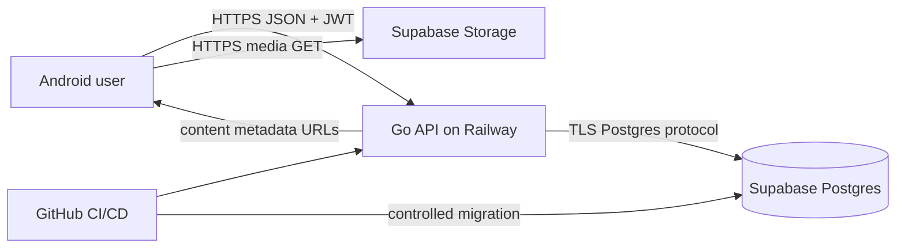
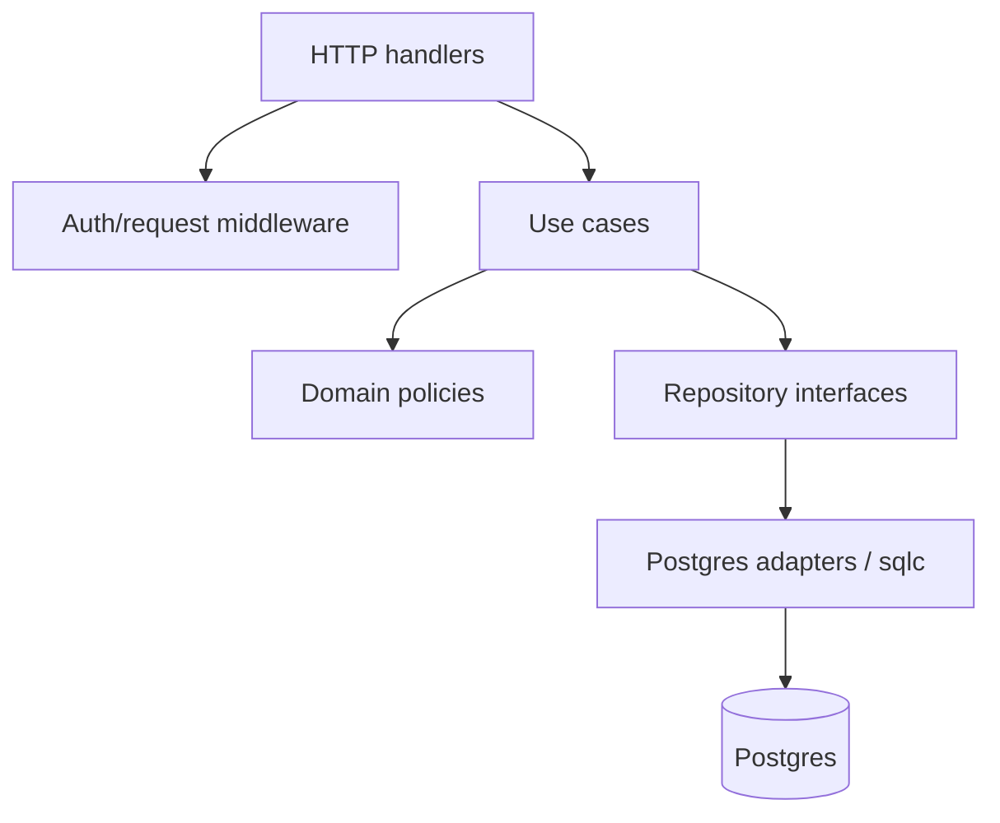
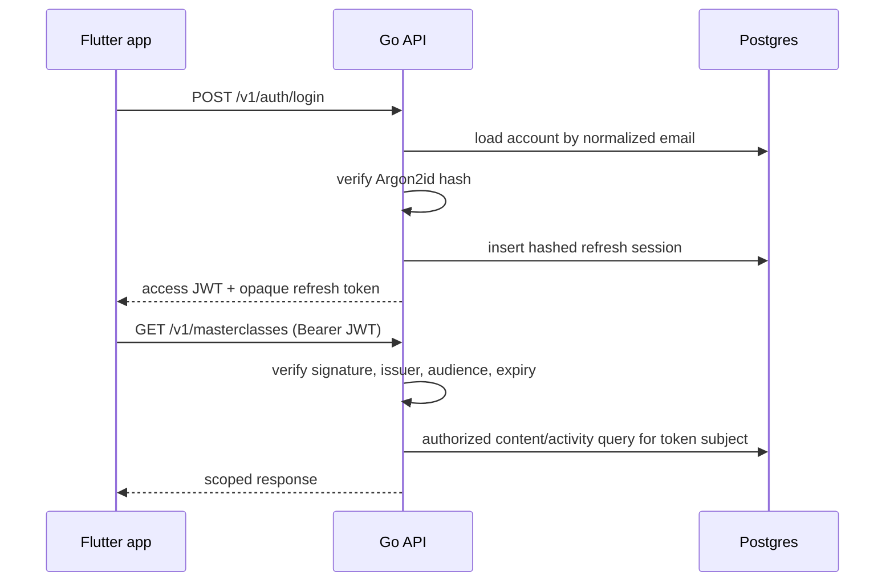

# System Architecture

**Status:** Draft for review  
**Last updated:** 2026-10-16  

## Context



The APK is untrusted. It may improve user experience, but every identity, authorization, role, and integrity decision is repeated by the backend.

## Trust boundaries

1. **Device boundary:** tokens stored on a user's device may be extracted on a compromised device. Limit access-token lifetime and support refresh revocation.
2. **Public API boundary:** every request is hostile until parsed, authenticated, authorized, and validated.
3. **Database boundary:** only the Go service and controlled migration tooling receive database credentials.
4. **Public media boundary:** seeded videos contain no private user data and may be publicly readable.
5. **CI/deployment boundary:** secrets are stored in provider secret stores, never Git.

## Backend layers



- Middleware establishes a verified account identity and request ID.
- Handlers translate HTTP to typed commands and results.
- Use cases define transaction boundaries and orchestration.
- Domain policies calculate and validate business state.
- Repository adapters issue explicit SQL.
- Error mapping is centralized so internal errors do not leak.

## Authentication request lifecycle



## Invite redemption lifecycle

```mermaid
sequenceDiagram
    participant App
    participant API
    participant DB
    App->>API: POST /v1/invites/redeem {code, role}
    API->>API: normalize code, compute keyed digest
    API->>DB: BEGIN
    API->>DB: lock invite and family rows
    API->>DB: validate unused, unexpired, not self, user unassigned
    API->>DB: insert membership (unique user; unique family+role)
    API->>DB: mark invite redeemed
    API->>DB: COMMIT
    API-->>App: family and child summary
```

The database constraints remain decisive if two transactions pass application checks at nearly the same time.

## Progress write lifecycle

The app reports integer playback seconds. The service loads the canonical video duration and performs one upsert:

- `furthest_seconds = greatest(existing, clamped_incoming)`
- `last_watched_at = now()` for a valid event
- `completed_at` is set once when the resulting value reaches 90%
- `completed_at` is never cleared

The response returns the authoritative server calculation. No read-then-write race is allowed.

## Partner authorization model

Partner activity is never fetched from a client-supplied partner ID. For the authenticated user, SQL resolves:

1. Their sole family membership.
2. The other membership in that same family.
3. Activity rows belonging to that resolved account.

If any step is absent, partner fields are null. Generic content remains visible only to onboarded users under this release's product flow.

## Read-model strategy

Masterclass and detail endpoints return mobile-shaped read models containing:

- content metadata;
- own like/progress;
- partner role and activity, if linked;
- derived aggregate progress.

Queries use joins/CTEs or a small fixed number of batched queries. They must not issue a separate query per video.

## Availability and consistency

- Postgres is authoritative and transactionally consistent.
- A successful mutation is visible to later reads after commit.
- No application cache is required for the assignment.
- Pull-to-refresh provides cross-device convergence.
- Video objects are independent of API availability once the player has the URL.
- Railway liveness checks verify the process; readiness checks include a bounded database ping.

## Environment separation

- **Local:** local Postgres or an isolated development database; local media URLs may differ.
- **CI:** ephemeral Postgres service; never uses production.
- **Production/demo:** Railway API, Supabase database/storage, release APK.

Demo and production are the same environment for this assignment. Seed operations must therefore be idempotent and narrowly scoped.
