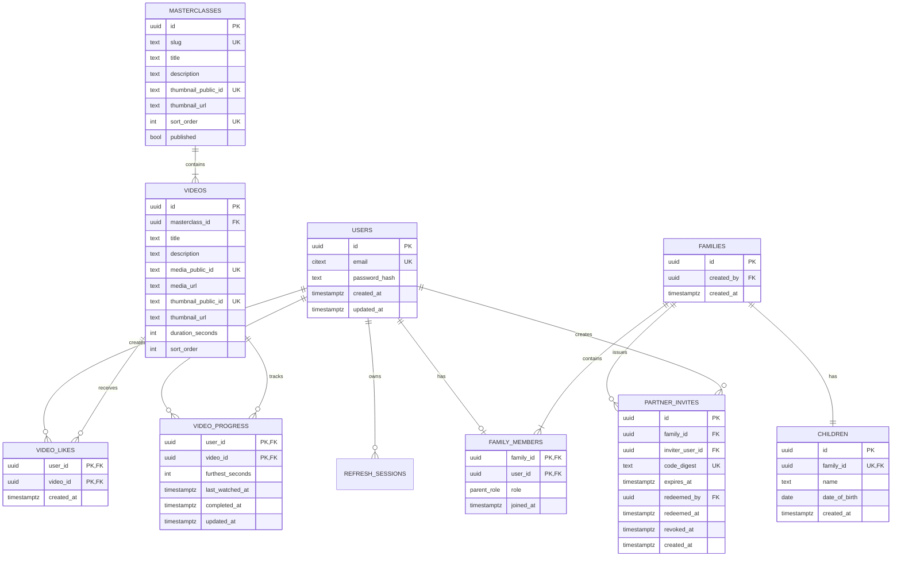

# Data Model

**Status:** Implemented and handover-aligned
**Last updated:** 2026-10-16  

## Modeling principles

- UUID primary keys avoid exposing sequential account counts.
- UTC timestamps use timezone-aware Postgres types.
- Email comparison is case-insensitive.
- Roles live on family membership, where uniqueness matters.
- Constraints enforce invariants even when requests race.
- Raw passwords, refresh tokens, and invite codes are never stored.
- Content durations are canonical backend values, not trusted client values.

## Entity relationship diagram



## Tables and constraints

### `users`

- `id uuid primary key`
- `email citext not null unique`
- `password_hash text not null`
- `created_at`, `updated_at timestamptz not null`
- Normalized email is trimmed; syntactic validation occurs in the service.

### `refresh_sessions`

- `id uuid primary key`
- `user_id uuid not null references users on delete cascade`
- `token_digest text not null unique`
- `family_id uuid not null` identifies a rotation chain, not a Sitaara family.
- `parent_session_id uuid null references refresh_sessions`
- `expires_at timestamptz not null`
- `used_at`, `revoked_at`, `created_at timestamptz`
- Index on `(user_id, revoked_at, expires_at)`.

### `families`

- `id uuid primary key`
- `created_by uuid not null references users`
- `created_at timestamptz not null`
- Creator identity is audit information; permissions derive from membership.

### `family_members`

- Composite primary key `(family_id, user_id)`.
- `user_id` also has a unique constraint, enforcing one family per user.
- Unique `(family_id, role)` enforces one Mom and one Dad.
- `role` uses enum/check values `mom`, `dad`.
- Because only two roles exist, the role uniqueness constraint limits a family to two members.

### `children`

- `family_id unique not null` enforces one child per family.
- Trimmed `name` length is 1-80.
- DOB validation is performed inside the family-creation transaction using the service clock. A trigger may duplicate the rule for defense in depth; a static check using `current_date` is avoided because time-relative checks age.
- No update/delete endpoint exists in this release.

### `partner_invites`

- Raw code is returned once and never stored.
- `code_digest` is an HMAC/keyed digest with a server secret because a six-character code has low entropy.
- `redeemed_by` and `redeemed_at` are both null or both non-null.
- A partial unique index permits at most one unredeemed, unrevoked row per inviter. Generation revokes previous rows before insertion.
- Index `code_digest` for redemption lookup and `(inviter_user_id, created_at)` for audit.

### `masterclasses` and `videos`

- `sort_order` is non-negative and unique within its parent scope.
- Video duration must be positive.
- Cloudinary public IDs are retained alongside delivery URLs so assets can be audited, replaced, or transformed without identifying them by a derived URL alone.
- Public IDs are unique within their resource type and use a project-owned folder/prefix.
- Media and thumbnail delivery URLs must be HTTPS in the seeded hosted environment. The API returns these URLs as opaque strings to Flutter.
- Published content is readable; content mutation is migration/seed controlled.

### `video_likes`

- Composite primary key `(user_id, video_id)` prevents duplicates.
- Like uses `insert ... on conflict do nothing`.
- Unlike uses `delete`, with zero deleted rows still considered success.

### `video_progress`

- Composite primary key `(user_id, video_id)`.
- `furthest_seconds >= 0`.
- Service clamps incoming values to the video's duration.
- Atomic upsert uses `greatest` and never clears `completed_at`.
- `last_watched_at` tracks valid recent activity even if furthest progress is unchanged.
- Index `(user_id, last_watched_at desc)` supports current-watching lookup.

## Transaction boundaries

- Register account plus initial refresh session.
- Create family, creator membership, and child.
- Generate invite: revoke prior active invite and insert successor.
- Redeem invite: lock, validate, insert membership, mark redeemed.
- Refresh token: consume predecessor and create successor.
- Progress upsert: one atomic statement, optionally with video-duration lookup in the same transaction.

## Aggregate definitions

For each video, watched seconds are `min(furthest_seconds, duration_seconds)`, or zero without a progress row.

```text
masterclass_percentage =
  floor(100 * sum(watched_seconds) / sum(duration_seconds))
```

Return `0` defensively if total duration is zero, though seeded data forbids that state. Completed count is the number of videos with non-null `completed_at`.

## Deletion policy

No user-facing deletion exists. Foreign keys still use intentional behavior:

- Session, likes, and progress may cascade with a user in administrative cleanup.
- Family/member/child/invite history should not be accidentally deleted by content operations.
- Seeded content should not be deleted after activity exists; later migrations can use soft publication state.

## Migration policy

- Migrations are append-only after shared deployment.
- Each migration has a deterministic up/down path where safe.
- Seed content is separate from schema but idempotent.
- CI applies all migrations to an empty database and runs integration tests.
